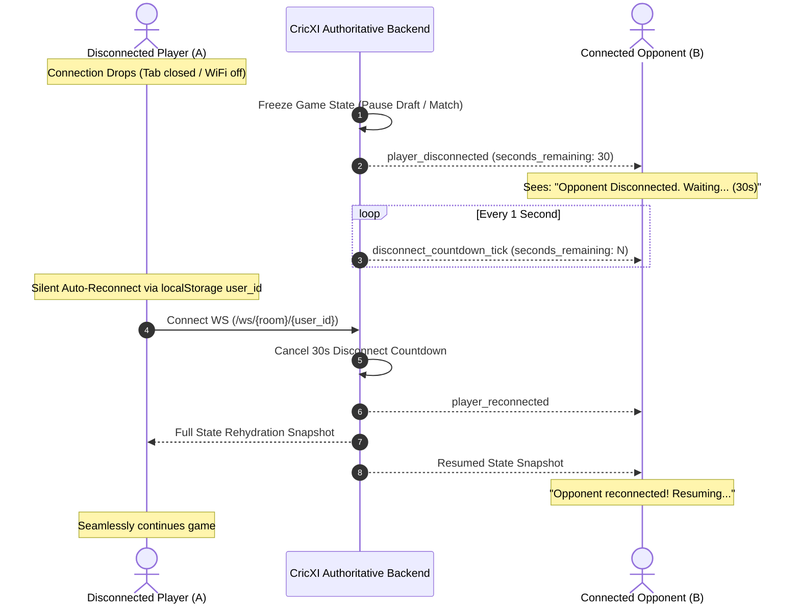

# CricXI Phase 6.2 — Multiplayer Disconnect Recovery & Session Persistence Audit

## Executive Summary
This production audit and hardening update addresses the critical multiplayer disconnect lifecycle and tab switching flaws identified during testing. The system now mirrors commercial online multiplayer games (e.g., Chess.com, Clash Royale) with a heartbeat mechanism, strict differentiation between backgrounding and real disconnections, server-authoritative 30-second countdowns, slot reservation against hijacking, and silent client-side reconnection.

---

## 1. Disconnect vs. Backgrounding Classification

### Non-Disconnect Events (MUST NOT disconnect)
The following events **do not** trigger a disconnect:
- Switching browser tabs
- Alt+Tab between applications
- Opening browser DevTools
- Minimizing the browser window
- Brief mobile backgrounding / screen locking
- Chrome background timer throttling (down to 1 execution/second)
- Window blur or focus events
- Document `visibilitychange` events

**Rule Enforced**: Neither `document.visibilitychange`, `window.blur`, nor `window.focus` are used as disconnect triggers. When a tab becomes visible after backgrounding, an immediate heartbeat ping is sent to refresh state seamlessly.

### Real Disconnect Events (Trigger Server Disconnect Lifecycle)
The 30-second disconnect timer is triggered **only** when:
- Browser tab containing CricXI is closed
- Entire browser is closed
- Browser process is terminated (Task Manager / Force Quit)
- Device powers off or sleeps
- Internet connection is lost / WiFi disabled / Airplane mode enabled
- WebSocket connection terminates (`WebSocketDisconnect` / TCP FIN)
- Heartbeat timeout expires (> 12 seconds with zero activity)
- User explicitly clicks **Leave Room** or **Lobby** (handled as an intentional, immediate exit)

---

## 2. Heartbeat System Architecture

| Component | Interval / Timeout | Description |
| :--- | :--- | :--- |
| **Client Heartbeat** | `3,000 ms` | Client sends `{"type": "heartbeat", "timestamp": Date.now(), "player_id": id}` every 3 seconds. |
| **Server Heartbeat Ack** | Immediate | Server records `last_heartbeat[room_code][player_id] = time.time()` and responds with `{"type": "heartbeat_ack"}`. |
| **Watchdog Timeout** | `12.0 s` | Server's `asyncio.wait_for(websocket.receive_text(), timeout=12.0)` detects connection drops (e.g. WiFi turned off, plane mode) within 12 seconds while safely tolerating minor jitter and inactive tab throttling. |

---

## 3. Asymmetric Disconnect Overlay ("Only Opponent Sees Disconnected")

Previously, both players received the "Opponent Disconnected" banner. In Phase 6.2:



- **Player A (Disconnected)**: Attempts automatic reconnection silently in the background. Does **not** display an "Opponent Disconnected" banner about themselves.
- **Player B (Connected Opponent)**: Receives `player_disconnected` and real-time `disconnect_countdown_tick` messages. Displays:
  ```
  Opponent Disconnected. Draft/Match timer is paused. Waiting for opponent to reconnect... (28s)
  ```

---

## 4. Game State Freezing & Delivery Integrity

When an unexpected disconnect occurs:

### Draft Phase
- `DraftService.pause_draft(db, room_code)`:
  - Exact remaining seconds are calculated and stored in `draft_state.remaining_seconds`.
  - `draft_state.turn_deadline` is set to `None`.
  - `draft_manager.stop_room_timer(room_code)` halts the background countdown ticker.
- On Reconnect:
  - `DraftService.resume_draft(db, room_code)` recomputes `turn_deadline = now + timedelta(seconds=remaining_seconds)`.
  - `draft_manager.start_room_timer(room_code)` restarts the countdown ticker with the exact remaining seconds preserved.

### Toss Phase
- Coin flips, caller identities, and decisions persist authoritatively in `toss_state`.
- On reconnect, the exact step (`CALLING` or `DECIDING`) is rehydrated. No coin flip is re-run.

### Live Match Phase
- Match simulation halts immediately via `match_manager.stop_match_simulation(room_code)` and `MatchService.set_simulation_controls(action="pause")`.
- All match fields (`innings`, `overs`, `legal_balls_bowled`, `total_runs`, `total_wickets`, `current_striker_id`, `current_bowler_id`) remain frozen.
- On reconnect, `set_simulation_controls(action="play")` and `match_manager.start_match_simulation` resume delivery simulation from the exact next delivery without duplicate balls or skips.

---

## 5. Slot Reservation & Account Hijacking Prevention

- When a player disconnects, their slot in `RoomPlayer` is reserved for **30 seconds**.
- **Reconnecting Player** (matching persistent `user_id`):
  - `RoomService.join_room` immediately restores their session without `"Room is already full"`.
  - WebSocket `/ws/{room_code}/{user_id}` accepts the connection and cancels the countdown.
- **Third-Party Intruder** (different `user_id`):
  - Rejected by REST API (`join_room`) with:
    `"Player slot reserved. Waiting for original player to reconnect."`
  - Rejected by WebSocket with code `4003` and message:
    `"Player slot reserved. Waiting for original player to reconnect."`

---

## 6. Intentional Exit vs. 30s Timeout

### Intentional Exit (Clicking "Lobby" or "Leave")
- Client sends `{"type": "player_left", "intentional": true}`.
- Backend skips the 30-second reconnect window, marks the room completed/abandoned immediately, and notifies the opponent:
  `{"type": "player_left", "intentional": true, "message": "Opponent has left the match."}`.

### 30-Second Timeout Expiration
- If the 30-second countdown reaches 0 without reconnection:
  - `MatchService.abandon_match` or `DraftService.cancel_draft` awards the win to the connected player with:
    `"Match Abandoned - Opponent failed to reconnect within 30 seconds"`.
  - Scorecard statistics are validated and saved.
  - Broadcasts `disconnect_timeout` to the room and marks room `COMPLETED`.

---

## 7. Verification Results

| Test Category | Suite / Command | Result |
| :--- | :--- | :--- |
| **Multiplayer Session Recovery** | `backend/tests/test_multiplayer_session_recovery.py` (8 tests) | **8 / 8 Passed (0.89s)** |
| **Full Backend Suite** | `backend/tests/` (66 tests) | **66 / 66 Passed (5.41s)** |
| **Frontend Production Build** | `npm.cmd --prefix frontend run build` | **Clean Build (0 errors, 3.66s)** |
