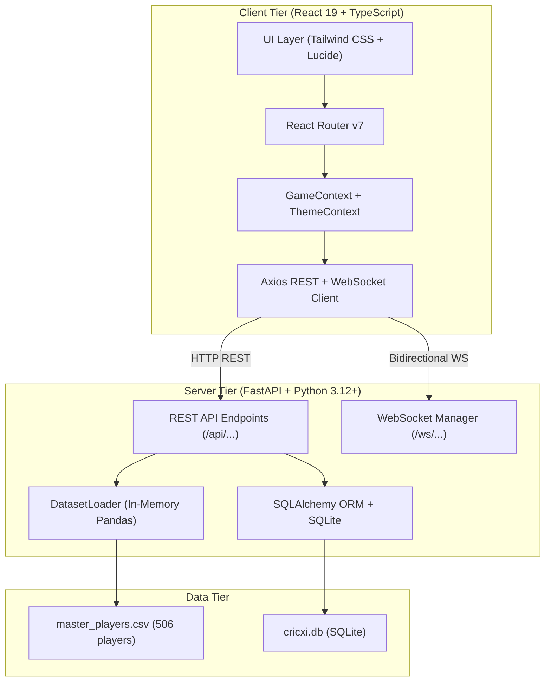
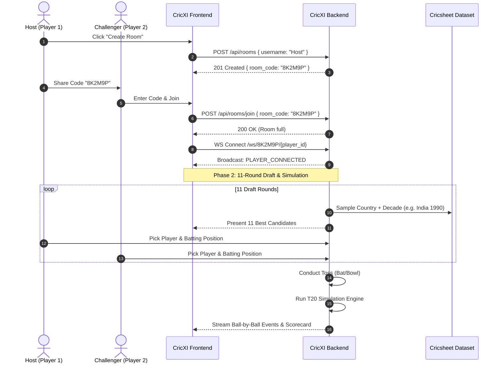

# CricXI System Architecture & Design Specification

## 1. System Overview

CricXI is an online multiplayer cricket draft and realistic T20 simulation platform built as an Introduction to Data Science project. Inspired by the draft mechanics of 500-0.com, CricXI introduces two-player online rooms, decade-based draft pools, authentic historical batting positions, real player metrics extracted from Cricsheet T20 international datasets, and an upcoming stochastic ball-by-ball simulation engine.

---

## 2. High-Level Architecture

---

## 3. Data Flow & Domain Lifecycle

---

## 4. Database Schema (SQLAlchemy Models)

### `players` Table
- `id` (Integer, Primary Key)
- `player_id` (Integer, Indexed)
- `player_name` (String, Indexed)
- `country` (String, Indexed)
- `decade` (Integer, Indexed)
- `batting_hand`, `bowling_hand`, `bowling_type`, `primary_role`, `eligible_positions`
- `is_captain`, `is_wicketkeeper`
- Batting statistics: `matches`, `innings`, `runs`, `strike_rate`, `batting_average`, `fifties`, `hundreds`, `sixes`, `fours`, `dot_ball_percentage`
- Bowling statistics: `wickets`, `balls_bowled`, `economy`, `bowling_average`, `maidens`, `four_wickets`, `five_wickets`
- Calculated ratings: `batting_rating`, `bowling_rating`, `overall_rating`

### `rooms` Table
- `id` (Integer, Primary Key)
- `room_code` (String(8), Unique, Indexed)
- `host_id` (String(100))
- `status` (Enum: WAITING, DRAFTING, TOSS, LIVE, COMPLETED, ABANDONED)
- `current_round` (Integer, Default: 1)
- `created_at`, `updated_at` (DateTime)

### `room_players` Table
- `id` (Integer, Primary Key)
- `room_id` (Foreign Key -> rooms.id)
- `user_id` (String(100), Indexed)
- `username` (String(50))
- `is_host` (Boolean)
- `is_ready` (Boolean)
- `joined_at` (DateTime)

### `draft_picks` Table
- `id` (Integer, Primary Key)
- `room_id` (Foreign Key -> rooms.id)
- `round_number` (Integer)
- `user_id` (String(100))
- `player_id` (Integer)
- `player_name` (String(100))
- `batting_position` (Integer, 1-11)
- `selected_country` (String(50))
- `selected_decade` (Integer)

### `matches` Table
- `id` (Integer, Primary Key)
- `room_id` (Foreign Key -> rooms.id)
- `team1_user_id`, `team2_user_id` (String(100))
- `toss_winner_id`, `toss_decision` (String)
- `status` (Enum: PENDING, IN_PROGRESS, FIRST_INNINGS, INNINGS_BREAK, SECOND_INNINGS, COMPLETED)
- `winner_user_id`, `result_margin` (String)

### `match_innings` & `ball_events` Tables
- Store granular ball-by-ball outputs for replay, live commentary streaming, and post-match scorecard calculation.

---

## 5. Security & Constraints
- Sandbox and environment independence.
- No client-side score computation: The server acts as the single source of truth for all drafting outcomes and match simulation logic.
- Input validation via Pydantic v2 schemas across all REST endpoints and WebSocket payloads.

